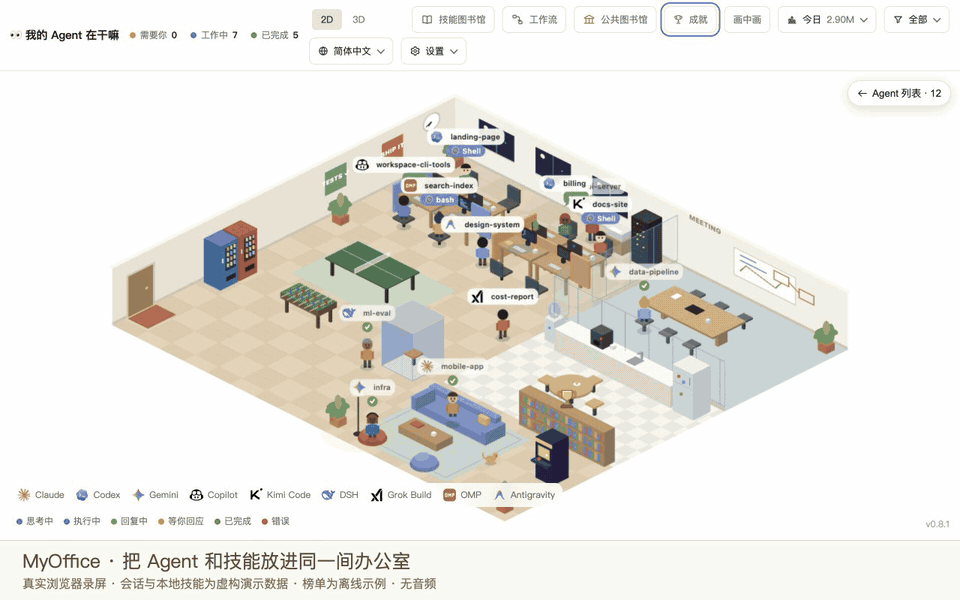
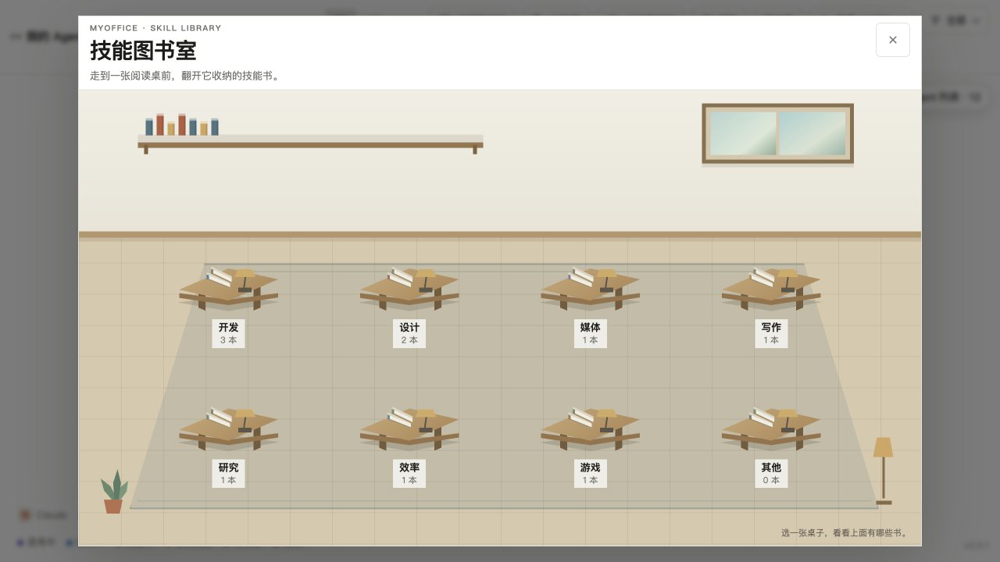
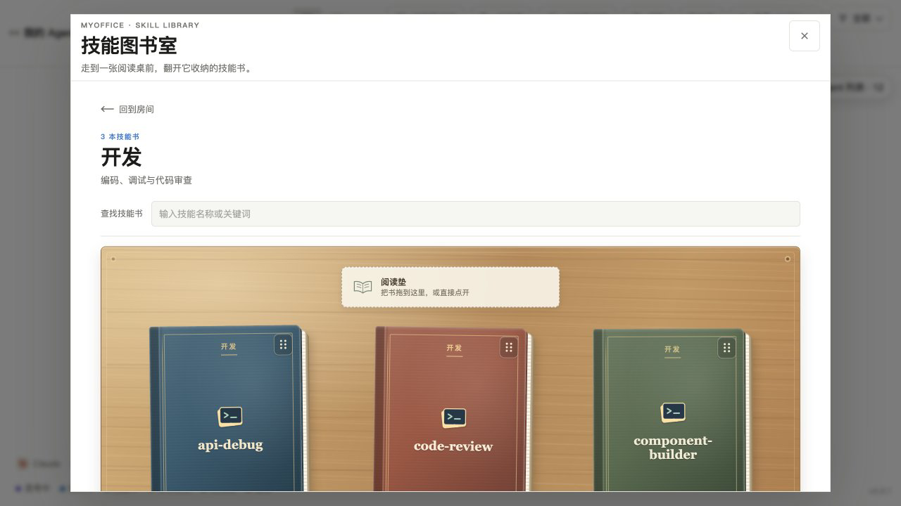
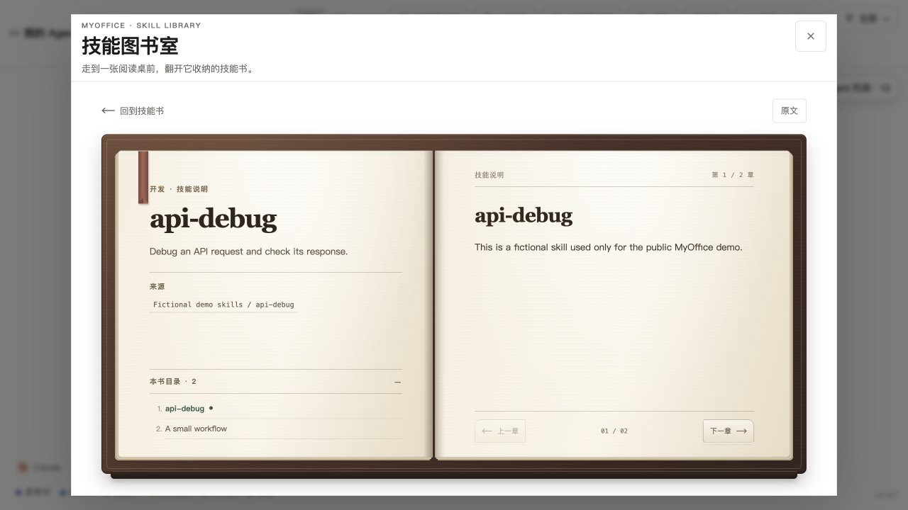
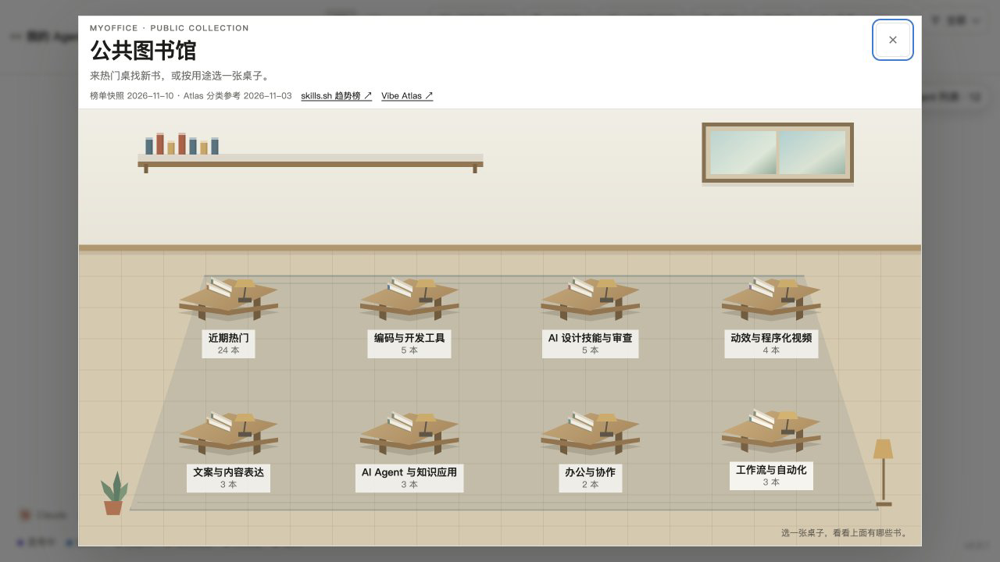
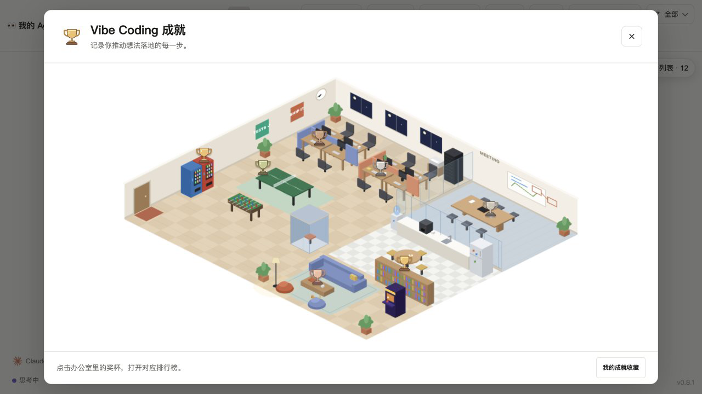
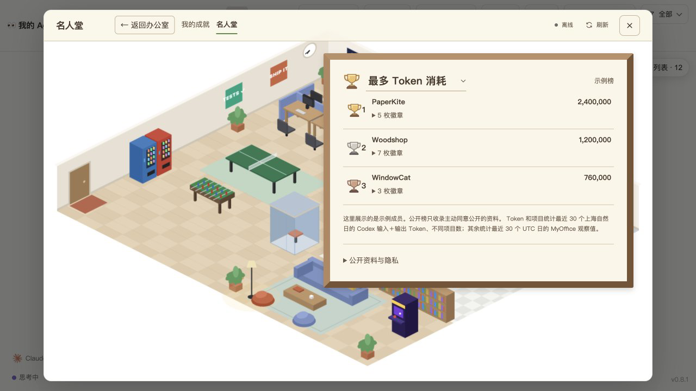

# MyOffice · Skills Library & Trophy Office

**技能图书馆与成就办公室。** MyOffice 是 `Charonyuu/whatsmyagentdoing` 的 MIT 许可 fork；本次社区更新标记为 `myoffice-v0.8.1-r1`。

## 看一段演示



[下载静音 MP4 演示](https://github.com/Angelov1314/whatsmyagentdoing/releases/download/myoffice-v0.8.1-r1/myoffice-demo.mp4) · [时间码与录制说明](docs/showcase/MEDIA.md)。

| 技能分类桌 | 卡通技能书 |
|---|---|
|  |  |

| 章节阅读器 | 公共技能目录 |
|---|---|
|  |  |

| 成就奖杯办公室 | 榜单示例 |
|---|---|
|  |  |

演示使用 `scripts/demo-showcase.cjs`：会话和本地技能都是合成的示例，榜单使用虚构示例项；没有读取真实会话、个人技能目录或私有目录。MP4 为静音录屏。离线示例榜单不是线上用户数据，当前也没有部署公共 Hall 服务。

## 安装并启动

需要 Node.js 18 或更新版本。克隆这个 fork，然后从仓库目录启动本机看板：

```bash
git clone --depth 1 https://github.com/Angelov1314/whatsmyagentdoing ~/.codex/skills/myoffice
cd ~/.codex/skills/myoffice
node bin/cli.js
```

看板会在浏览器打开。也可以在新的 Codex 会话中使用 `/myoffice`。Claude Code 用户可将安装目录改为 `~/.claude/skills/myoffice`。基础看板不需要 `npm install`；OpenCode、Hermes 和独立 Hall 服务有更高的 Node 版本要求，见下方说明。

## 本次更新

- **技能图书馆：** 按类别浏览和搜索本机 Codex、Claude Code 与 Agent Skills（含已启用插件）中的技能；打开分页阅读器查看技能说明。公开区提供一个随仓库发布的目录快照，可浏览名称、简介和来源链接。公开目录不是实时排行榜，也不会安装技能。
- **奖杯办公室与成就：** 在本机按最近 30 个 UTC 日记录主会话、活跃日、连续活跃天数和 Agent 类型，解锁徽章并累计积分。奖杯房间复用原版办公室场景；奖杯标签在鼠标悬停和键盘聚焦时显示。
- **七种榜单维度：** 积分、Token、项目数、会话数、活跃天数、最长连续天数、Agent 类型数。Token 和项目统计需可用的 Codex Token Dashboard 收集器；统计不可用时保留为空值，不伪装成零，也不会进入对应维度的排名。
- **工作流画布查看器：** 打开已生成的本地流程图；生成内容需另行使用 `$workflow-canvas` 技能。
- **Codex 用量面板：** 按日期、模型和项目筛选用量，查看图表与排行。费用是按 API 费率折算的估算，不是订阅或账单金额。
- **Social Workbench 接入：** 在看板中查看和编辑本机 Social Workbench 的账号关联、对话关联、发布记录及截图资料。此接入不直接调用 X 或其他平台的发布接口；平台操作由独立工作台自身决定。

原版实时办公室、会话来源、客户端选项及 2D/3D 场景仍在本 fork 中。完整上游原版说明保存在 [README.upstream.md](README.upstream.md)，上游项目为 [Charonyuu/whatsmyagentdoing](https://github.com/Charonyuu/whatsmyagentdoing)。

## 隐私与公开榜单

会话记录和本机技能内容由本机服务读取；本地成就默认保存在 `~/.whatsmyagentdoing/achievements-v1.json`。没有 Hall 配置时，成就保持离线。仓库包含 Hall 服务代码和运行说明，但没有随仓库部署公网服务器。

如果你自行配置 HTTPS Hall，MyOffice 会先生成只供你查看的预览。每次发布或更新都需要针对该预览重新勾选同意。发布资料包括公开昵称、徽章 ID、积分，以及六项汇总统计：Token、项目数、会话数、活跃天数、最长连续天数和 Agent 类型数。统计中不可用的值会作为 `null` 发送；这些数字会显示在公共榜单并可用于排名。不会发送提示词、会话文本、项目路径、源码或会话 ID。已发布资料会公开保留，直到你从 Hall 撤回。

## 可选接入与边界

- **公开 Hall：** 需要单独部署 Node.js 22.13+ 服务并配置 HTTPS 域名，再按 [hall/README.md](hall/README.md) 配置 MyOffice。没有公共实例由本仓库代为托管。Loopback HTTP 只用于本地预览，不能公开发布。
- **Token / 项目统计：** 需要伴随工具 Codex Token Dashboard。MyOffice 当前从 `~/Library/Application Support/Codex Token Dashboard/dashboard.py` 启动收集器，使用本机 `127.0.0.1:8766`；没有该工具时 Token 与项目统计不可用。估算费用不代表实际扣款。
- **Social Workbench：** 依赖 `~/Projects/local-dashboard/start.command` 和本机 `127.0.0.1:8769` 服务。该路径和端口目前固定。MyOffice 仅接入它的本机数据与编辑流程，不直接调用 X 或其他平台的发布接口；平台操作由独立工作台自身决定。
- **工作流：** 查看器读取 `~/.whatsmyagentdoing/workflows` 中由 `$workflow-canvas` 生成的文件；本仓库没有代替该技能生成工作流。
- **公开技能目录：** `assets/public-skills.json` 是 2026-11-10 的静态快照，分类参考 2026-11-03 的 Vibe Atlas，并提供公开来源链接。它不是实时排名或安装器。

## 来源与许可

本 fork 保留上游 MIT 许可和原作者信息。原版 3D 模型由 Kenney 提供并采用 CC0；公开技能目录记录来源与链接，分类说明注明 Vibe Atlas 来源。详见 [LICENSE](LICENSE)、[上游原版 README](README.upstream.md) 和 [技能图标出处](assets/agents/README.md)。
